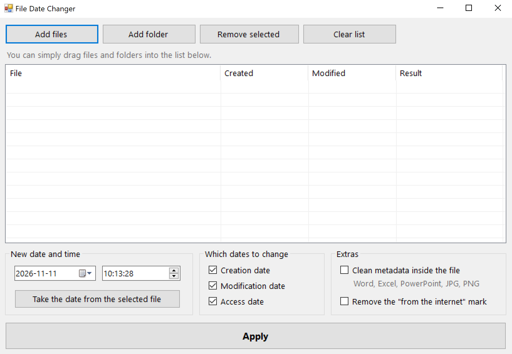

# FileDateChanger


A small Windows GUI tool that changes the **creation**, **modification** and
**access** dates of any file or folder, and optionally strips the metadata
stored inside documents and photos.

No installer, no console window, one 25 KB `.exe`. Everything is done with the
mouse.

🇷🇺 [Русская версия](README.ru.md)



> [!NOTE]
> The interface follows your Windows display language: English as shown
> above, Russian on a Russian system
> ([screenshot](docs/screenshot-ru.png)). Force one with `/en` or `/ru`.

## Interface language

The interface is English by default and Russian on a Russian Windows, chosen
from `CultureInfo.CurrentUICulture`. To override it:

```bat
FileDateChanger.exe /en
FileDateChanger.exe /ru
set FDC_LANG=en && FileDateChanger.exe
```

The date format follows the language too: `yyyy-MM-dd` in English,
`dd.MM.yyyy` in Russian.

## Features

- Drag and drop files and folders straight into the window
- Whole folders can be added, including everything inside them
- Pick the date from a calendar and the time down to the second
- Separate checkboxes for the creation, modification and access dates
- A "take the date from the selected file" button
- Optional metadata cleaning inside the file itself
- Removes the "downloaded from the internet" mark
- Read-only files are handled without clearing the attribute by hand
- The result for every file is shown in the list

## What metadata cleaning removes

| Format | Removed | Changed |
|---|---|---|
| `.docx` `.xlsx` `.pptx` and their macro/template variants | author, last modified by, company, manager, title, subject, keywords, category, total editing time, custom fields | internal creation and modification dates set to the chosen date, revision number reset to 1, archive entry times set to the chosen date |
| `.jpg` `.jpeg` | EXIF (camera, GPS, capture date), XMP, IPTC, comments | nothing, the image is not re-encoded |
| `.png` | text chunks, EXIF, timestamp | nothing, the image itself is untouched |
| `.pdf` `.doc` `.xls` `.ppt` and the rest | not supported | the program says so in the "Result" column |

> [!WARNING]
> Metadata cleaning cannot be undone. Work on copies.

> [!NOTE]
> The program does not remove the authors of comments and tracked changes
> inside Word text. For that use Word itself:
> **File → Info → Check for Issues → Inspect Document**.

## What you should know about dates

- The creation date lives only in the file system. Copy the file to another
  drive, a flash stick or the cloud and it usually becomes the current time.
- Sending a file by email or uploading it to a website does not carry the
  creation date at all.
- PDFs and the older Office formats keep dates of their own; this program does
  not touch them.

## Quick start

1. Download `FileDateChanger.exe` from the [Releases](../../releases) page.
2. Run it with a double click.
3. Drag files into the window, pick a date, press **Apply**.

Windows 10 or 11 is required. The .NET Framework 4.8 it needs is already
installed there.

## Building from source

The project is deliberately built without Visual Studio and without NuGet: one
source file and a build script.

### Windows (nothing to install)

Windows already ships the C# compiler as part of the .NET Framework.

```bat
build.bat
```

Double click `build.bat`. A couple of seconds later `bin\FileDateChanger.exe`
appears and starts.

The command by hand, if you want to see what happens:

```bat
%WINDIR%\Microsoft.NET\Framework64\v4.0.30319\csc.exe ^
  /nologo /codepage:65001 /target:winexe /optimize+ ^
  /out:bin\FileDateChanger.exe ^
  /r:System.IO.Compression.dll /r:System.IO.Compression.FileSystem.dll ^
  /r:System.Xml.Linq.dll /r:System.Windows.Forms.dll /r:System.Drawing.dll ^
  src\FileDateChanger.cs
```

| Switch | Why |
|---|---|
| `/target:winexe` | a windowed application, with no black console window |
| `/codepage:65001` | the source is UTF-8; without this the Russian interface text turns to mojibake |
| `/optimize+` | release build |
| `/r:...` | the .NET libraries it uses |

> [!IMPORTANT]
> The compiler built into Windows only understands C# 5. If you edit the code,
> do not use `$"..."`, `?.`, `nameof`, `out var` or anything else from C# 6 and
> later.

### Linux / macOS (via Mono)

The result still runs on Windows.

```bash
# Ubuntu / Debian
sudo apt install mono-devel

# macOS
brew install mono

./build.sh
```

The finished file: `bin/FileDateChanger.exe`.

### Releases

Pushing a tag that starts with `v` builds the executable on a Windows runner
and publishes it as a release, together with its SHA-256 checksum:

```bash
git tag v1.1.0
git push origin v1.1.0
```

The binary attached to a release is therefore compiled in public, from the
source in this repository, rather than uploaded from somebody's machine. See
[.github/workflows/release.yml](.github/workflows/release.yml).

## Project layout

```
FileDateChanger/
├── src/
│   └── FileDateChanger.cs   # everything: the interface, the dates, the metadata cleaning
├── docs/
│   ├── screenshot-en.png
│   └── screenshot-ru.png
├── .github/workflows/
│   └── release.yml          # builds and publishes a release when a tag is pushed
├── build.bat                # build on Windows
├── build.sh                 # build on Linux/macOS
├── README.md                # this file
└── README.ru.md             # the same in Russian
```

## How it works

- **Dates** are set with the standard `File.SetCreationTime /
  SetLastWriteTime / SetLastAccessTime`. They are applied last, after the
  metadata cleaning, because the cleaning would otherwise change the
  modification date itself. Dates whose checkbox is off are restored to their
  original values.
- **Office** files are ZIP archives. The program rewrites `docProps/core.xml`,
  `docProps/app.xml` and `docProps/custom.xml`, and sets the time on every
  entry of the archive.
- **JPEG** is walked marker by marker; the `APP1`, `APP12`, `APP13` and `COM`
  segments are dropped and everything else is copied byte for byte. The colour
  profile (`APP2`) and `APP14` are kept.
- **PNG** is walked chunk by chunk; `tEXt`, `zTXt`, `iTXt`, `eXIf` and `tIME`
  are removed.
- **The "from the internet" mark** is a hidden `Zone.Identifier` stream, which
  the program deletes.

## The SmartScreen warning

The first time you run a downloaded `.exe`, Windows may say "Windows protected
your PC". This happens to every program without a paid code-signing
certificate.

Your options:

1. **Build it yourself with `build.bat`.** A file compiled on your own machine
   is not marked as downloaded, so SmartScreen does not check it.
2. **Unblock it once:** right click `FileDateChanger.exe` → **Properties** →
   tick **Unblock** at the bottom → **OK**.
3. Click **More info → Run anyway**.

Every release also ships a `.sha256` file, so you can check that the download
matches what the build produced.

## Licence

[MIT](LICENSE).
